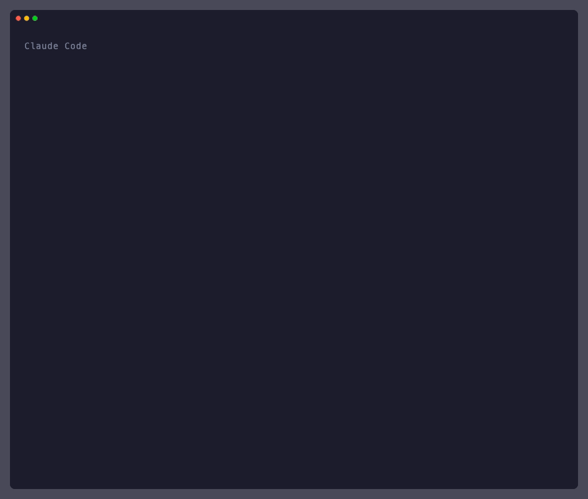

# AI Coder's Library

A curated directory of skills, tools, agents and models for developers who build with AI coding assistants.

Entries are selected for practical value in day-to-day AI-assisted development. Each one has a clear purpose, a working install path and broad adoption in the developer community, and most are open source. Every entry states what it does, when it fits, what it works with and how to start; paid plans, licence limits and inactive projects are called out where they apply.

Inclusion is not an endorsement or a security review. Read a tool's licence and the permissions it asks for before you install it, especially agents that run code and security tools.

## Ask your AI what fits you

Paste this into your coding assistant:

> Read https://raw.githubusercontent.com/caglarsu/ai-coders-library/main/llms.txt and the section files it links to that matter for me, then tell me which entries are worth installing for how I work. Ask me what you need to know first.

A real Claude Code session, shortened.

## For AI assistants reading this

This page is long and may reach you cut off or summarised. Read the plain-text index instead: https://raw.githubusercontent.com/caglarsu/ai-coders-library/main/llms.txt. It names every entry with its link and points to one small file per section ([catalog/](catalog/)).

A user sent you this repo to find out which entries suit them. To answer:

1. Find out, if you do not already know: which coding assistant they use, their languages and stack, and what slows them down today.
2. Drop entries whose **Works with** column excludes their assistant.
3. If they ask about security tools, check that they own or are authorised to test the target before recommending an active scanner or AI pentester.
4. Recommend at most five entries, best fit first; when two fit equally, prefer the one with more **Stars**. Stars can be bought or gamed, so treat them as a tie-breaker only, never as proof of quality. For each give the name, one line on why it fits *this* user, and the **Install** step.
5. For video and voice models, check the live leaderboards linked in the Video creation and Audio sections; the ranks in this file are a dated snapshot.
6. For models, give the **Run** line instead of an install step.
7. If nothing here fits, say so. Do not pad the list.

## Contents

- [Coding agents](#coding-agents): the agents themselves, in terminal, IDE and editor
- [Skills](#skills): skill packs and plugins that change how your coding assistant works
- [Agents](#agents): standalone AI agents you run yourself
- [Tools](#tools): CLIs and engines that sit next to your assistant, and free local LLMs to run
- [Video creation](#video-creation): code-driven video, AI video pipelines, and the best free video models
- [Audio](#audio): local speech, voice and music engines, and the best free voice and speech-to-text models
- [Mobile apps](#mobile-apps): run open models on your phone, offline
- [App security](#app-security): scanners and AI pentesters for the code your assistant writes, and compliance automation
- [Learning](#learning): courses, guides and other curated lists
- [Workflows](#workflows): repeatable practices that make AI-written code trustworthy

## Coding agents

| Name | Stars | What it does | Use it when | Works with | Install |
| ---- | ----- | ------------ | ----------- | ---------- | ------- |
| [DeepSeek Harness](https://github.com/deepseek-ai/deepseek-harness) | ★ 287.1k | DeepSeek's plugin-based agent harness. | You use DeepSeek models and want their official agent. | DeepSeek and other providers | `npx @deepseek-ai/dsh web` |
| [OpenCode](https://github.com/anomalyco/opencode) | ★ 229.2k | Open-source coding agent that works with almost any model provider. | You want a Claude Code-style agent without being tied to one vendor. | Any provider, local models | `curl -fsSL https://opencode.ai/v2/install \| bash` |
| [Claude Code](https://github.com/anthropics/claude-code) | ★ 157.1k | Anthropic's agentic coding tool for the terminal, IDE and desktop. | You want the agent most skills in this library are built for. Needs a Claude plan or API key. | macOS, Linux, Windows | `curl -fsSL https://claude.ai/install.sh \| bash` |
| [Codex](https://github.com/openai/codex) | ★ 136.5k | OpenAI's open-source coding agent for the terminal. | You use ChatGPT or OpenAI models. Needs a ChatGPT plan or API key. | macOS, Linux, Windows | `npm install -g @openai/codex` |
| [Pi](https://github.com/earendil-works/pi) | ★ 123.9k | Minimal, hackable agent toolkit: unified LLM API, agent loop, TUI and coding agent CLI. | You want a small agent you can read, extend or build your own on. | Any provider | `npm install -g --ignore-scripts @earendil-works/pi-coding-agent` |
| [Gemini CLI](https://github.com/google-gemini/gemini-cli) | ★ 109.1k | Google's open-source terminal agent for Gemini models. | You want a terminal agent with a free tier through a Google account. | macOS, Linux, Windows | `npm install -g @google/gemini-cli` |
| [Zed](https://github.com/zed-industries/zed) | ★ 95.7k | Fast, multiplayer code editor with built-in AI agents. | You want an editor built around AI agents rather than an extension bolted on. | macOS, Linux, Windows | Download from zed.dev |
| [OpenHands](https://github.com/OpenHands/OpenHands) | ★ 94.3k | Open platform for autonomous software-development agents, local or cloud. | You want agents that take a whole issue to a pull request in a sandbox. | Docker; any model provider | `npm install -g @openhands/agent-canvas` |
| [Cline](https://github.com/cline/cline) | ★ 71.9k | Autonomous coding agent as a VS Code extension, CLI or SDK. | You want an agent inside VS Code that asks before each action, with your own API keys. | VS Code, JetBrains, CLI | `npm i -g cline`, or install from the VS Code marketplace |
| [Goose](https://github.com/aaif-goose/goose) | ★ 57k | Extensible open-source agent that installs, runs, edits and tests with any LLM. | You want a general local agent with MCP extensions beyond coding. | Any provider; desktop app and CLI | `curl -fsSL https://github.com/aaif-goose/goose/releases/download/stable/download_cli.sh \| bash` |

## Skills

| Name | Stars | What it does | Use it when | Works with | Install |
| ---- | ----- | ------------ | ----------- | ---------- | ------- |
| [Matt Pocock's skills](https://github.com/mattpocock/skills) | ★ 332.9k | Matt Pocock's own engineering skills, straight from his agent setup. | You want battle-tested everyday skills from a well-known TypeScript educator. | Claude Code, Codex | `claude plugin install mattpocock-skills@claude-plugins-official` |
| [Superpowers](https://github.com/obra/superpowers) | ★ 326.6k | Skills framework that makes the agent brainstorm, plan, write tests first, debug systematically and verify before claiming done. | Your assistant jumps straight to code, skips tests, or says "fixed" without checking. | Claude Code, Codex, Gemini CLI, OpenCode, Cursor | `/plugin install superpowers@claude-plugins-official` |
| [ECC](https://github.com/affaan-m/ECC) | ★ 310.8k | Agent harness pack: skills, instincts, memory, security checks and research-first development. | You want one install that tunes your whole agent setup rather than single skills. | Claude Code, Codex, OpenCode, Cursor | `npx ecc-universal@2.2.3 setup` |
| [Karpathy Skills](https://github.com/multica-ai/andrej-karpathy-skills) | ★ 235.7k | One CLAUDE.md that counters the LLM coding pitfalls Andrej Karpathy described. | You want a single drop-in file that makes the agent more careful. | Claude Code and any agent that reads CLAUDE.md | `curl -o CLAUDE.md https://raw.githubusercontent.com/forrestchang/andrej-karpathy-skills/main/CLAUDE.md` |
| [Anthropic Skills](https://github.com/anthropics/skills) | ★ 200.6k | Anthropic's official agent skills: documents, design, testing and more, plus examples to copy. | You want the reference skills, or a template for writing your own. | Claude Code, Claude apps, API | `/plugin marketplace add anthropics/skills` |
| [Ponytail](https://github.com/DietrichGebert/ponytail) | ★ 198.8k | Makes the agent take the simplest solution that works: stdlib before dependencies, one line before fifty. | Your assistant over-engineers: extra abstractions, new dependencies, boilerplate "for later". | Claude Code, Codex | `/plugin marketplace add DietrichGebert/ponytail` then `/plugin install ponytail@ponytail` |
| [UI UX Pro Max](https://github.com/nextlevelbuilder/ui-ux-pro-max-skill) | ★ 154.2k | Design intelligence skill for professional UI across web and mobile. | Your agent's interfaces look amateur and you want design rules applied. | Claude Code and other agents | `/plugin marketplace add nextlevelbuilder/ui-ux-pro-max-skill` then `/plugin install ui-ux-pro-max@ui-ux-pro-max-skill` |
| [Graphify](https://github.com/Graphify-Labs/graphify) | ★ 153.4k | Turns a codebase, docs, SQL schemas and PDFs into a queryable knowledge graph using local AST parsing, no vector store. | Your repo is large and the agent burns tokens grepping and reading files to find its way. | Claude Code, Cursor, Codex, Gemini CLI | `uv tool install graphifyy`, then `/graphify` in your assistant |
| [Spec Kit](https://github.com/github/spec-kit) | ★ 151.4k | GitHub's toolkit for spec-driven development: write the spec, then let the agent build to it. | Your agent drifts on larger features and you want a spec it must follow. | Copilot, Claude Code, Gemini CLI and others | `uv tool install specify-cli`, then `specify init my-project` |
| [gstack](https://github.com/garrytan/gstack) | ★ 142.7k | Garry Tan's Claude Code setup: slash commands acting as CEO, eng manager, designer, reviewer, QA with a real browser, security officer and release engineer. | You ship a product alone and want product, design, QA and release roles, not just a coder. | Claude Code (others partly); needs Git and Bun | `git clone --single-branch --depth 1 https://github.com/garrytan/gstack.git ~/.claude/skills/gstack && cd ~/.claude/skills/gstack && ./setup` |
| [Awesome DESIGN.md](https://github.com/VoltAgent/awesome-design-md) | ★ 129.1k | DESIGN.md files distilled from well-known brands' design systems. | You want your agent to build UI in a specific, consistent visual style. | Any agent | Copy a DESIGN.md into your project |
| [Caveman](https://github.com/JuliusBrussee/caveman) | ★ 122.9k | Skill and local proxy for shorter answers and smaller tool output, with every original recoverable. | You want to cut token spend and wordy replies. | Claude Code, Codex and other agents | `npx skills add JuliusBrussee/caveman -g` |
| [Taste Skill](https://github.com/Leonxlnx/taste-skill) | ★ 121.6k | Gives agents design taste: art direction, reference images and a browser check. | You want pages that do not look like generic AI output. | Claude Code and other agents | `/plugin marketplace add Leonxlnx/taste-skill` then `/plugin install taste-skill@taste-skill` |
| [Addy Osmani's agent skills](https://github.com/addyosmani/agent-skills) | ★ 120.4k | 26 production-grade engineering skills, such as code review, testing and performance. | You want a broad, well-maintained set of engineering habits for your agent. | Claude Code, Codex, Cursor and others | `npx skills add addyosmani/agent-skills` |
| [Impeccable](https://github.com/pbakaus/impeccable) | ★ 116.9k | Design vocabulary for your agent: commands to polish, critique and audit UI, and a detector for AI-slop design. | Your agent builds UI that looks generic and you want it to look designed. | Claude Code and other agents; Chrome or Edge for page scans | `npx impeccable install` |
| [Archify](https://github.com/tt-a1i/archify) | ★ 99.9k | Turns an idea, plan or codebase into a validated interactive architecture diagram. | You need architecture, sequence or data-flow diagrams that are checked before you see them. | Claude Code, Codex, Cursor, OpenCode, Copilot | `npx skills use tt-a1i/archify@archify --agent codex` (swap the agent name) |
| [Understand Anything](https://github.com/Egonex-AI/Understand-Anything) | ★ 94.5k | Builds an interactive knowledge graph of your code with guided tours, a dashboard and Q&A. | You are new to a codebase, or onboarding someone, and want to see its architecture. | Claude Code, Codex, Cursor, Copilot, Gemini CLI | `/plugin marketplace add Egonex-AI/Understand-Anything` then `/plugin install understand-anything` |
| [OpenSpec](https://github.com/Fission-AI/OpenSpec) | ★ 75.7k | Lightweight spec-driven development for AI coding assistants. | You want specs and change proposals without a heavy process. | Claude Code, Cursor, Codex and others | `npm install -g @fission-ai/openspec@latest` |
| [last30days](https://github.com/mvanhorn/last30days-skill) | ★ 75.1k | Researches a topic across Reddit, X, YouTube, Hacker News, Polymarket and the web, then writes a grounded summary. | You need to know what people are saying about a tool or topic right now. | Claude Code and other agents | `/plugin marketplace add mvanhorn/last30days-skill` then `/plugin install last30days` |
| [Humanizer](https://github.com/blader/humanizer) | ★ 73.6k | Removes the tell-tale signs of AI-generated writing from text. | Your docs, posts or emails read like a chatbot wrote them. | Claude Code, Codex and others | `/plugin marketplace add blader/humanizer` then `/plugin install humanizer@humanizer` |
| [Diagram Design](https://github.com/cathrynlavery/diagram-design) | ★ 73.1k | 52 editorial diagram types as self-contained HTML and SVG, styled to match your site. | You want diagrams for docs or a blog that look like they belong there, not like Mermaid. | Claude Code, Codex, Copilot, Cursor and others | `npx skills add cathrynlavery/diagram-design` |
| [CLI-Anything](https://github.com/HKUDS/CLI-Anything) | ★ 65.7k | Generates agent-friendly CLIs for desktop software (CAD, 3D, office, media) and hosts a hub of community-built ones. | You want your agent to drive an app that has no API or CLI of its own. | Claude Code, any agent that runs shell commands | `/plugin marketplace add HKUDS/CLI-Anything` then `/plugin install cli-anything`; hub: `pip install cli-anything-hub` |
| [Marketing Skills](https://github.com/coreyhaines31/marketingskills) | ★ 62.7k | Marketing skills: conversion, copywriting, SEO, analytics and growth engineering. | You built the product and now need landing pages, copy and growth work done well. | Claude Code and other agents | `npx skills add coreyhaines31/marketingskills` |
| [i-have-adhd](https://github.com/ayghri/i-have-adhd) | ★ 62.4k | Makes the agent lead with the next action, number steps and stop burying the answer. | Long agent replies lose you, or you want answers you can act on at a glance. | Claude Code and other agents | `claude plugin marketplace add ayghri/i-have-adhd` then `claude plugin install i-have-adhd@i-have-adhd` |
| [BMAD Method](https://github.com/bmad-code-org/BMAD-METHOD) | ★ 55.8k | Agile AI-driven development method with planning, architecture and dev agent roles. | You want a full agile process run by agents, from brief to stories to code. | Claude Code, Cursor and others | `npx bmad-method install` |
| [Obsidian Skills](https://github.com/obsidianmd/obsidian-skills) | ★ 53.8k | Teaches your agent Obsidian and open formats: Markdown, Bases, JSON Canvas. | You keep notes or docs in Obsidian and want the agent to edit them properly. | Claude Code and other agents | `claude plugin marketplace add obsidianmd/obsidian-skills` then `claude plugin install obsidian@obsidian-skills` |
| [Get Shit Done](https://github.com/open-gsd/gsd-core) | ★ 11.8k | Meta-prompting, context engineering and spec-driven development system, now maintained as GSD Core. | You want structure for long agent projects without much ceremony. | Claude Code, OpenCode, Codex, Cursor, Copilot and more | `npx @opengsd/gsd-core@latest` |
| [rust-anything](https://github.com/erkamyaman/rust-anything) | ★ 9.6k | Rewrites an app in Rust one piece at a time, checking each step against the original's recorded behaviour. | You want to port a TypeScript or Python CLI, server or library to Rust without breaking it. | Claude Code; Rust toolchain | `cargo install rust-anything` |
| [OpenFilm](https://github.com/openfilm/openfilm) | ★ 9.4k | Open-source AI video agent: your coding agent finds footage, music and voices, writes each shot and cuts the film while you watch, and you can point at anything or edit it by hand. | You want an agent to make a whole video and then change it yourself on a timeline. | Claude Code, Codex; desktop app for macOS and Windows | `npx skills add openfilm/openfilm` (Node 22.2+, ffmpeg), or the desktop app from its releases |
| [App Store Compliance](https://github.com/mjmirza/app-store-compliance) | ★ 6.5k | Pre-submission guard with 124 documented App Store and Google Play rejection patterns and fixes. Free under $20M yearly revenue. | You are about to submit a mobile app and want to avoid a rejection. | Any agent that reads files | `git clone https://github.com/mjmirza/app-store-compliance` |
| [hyperresearch](https://github.com/jordan-gibbs/hyperresearch) | ★ 5.1k | Deep research skill: one prompt runs a multi-step pipeline over the web, scholarly papers, SEC filings and economic data, cite-checks every claim, and keeps every source in a searchable local vault. A paid hosted version also exists. | You want a cited research report from your coding agent instead of a chat answer. | Claude Code, Codex; Python 3.11+ | `pip install hyperresearch`, then `hyperresearch install` in your project and run `/hyperresearch <question>` |
| [motionmaxxing](https://github.com/Tejashmakwana/motionmaxxing) | ★ 1.8k | Agent skill for launch films, promos, brand stings and kinetic type, with timing measured from professional motion work; it renders the film and checks it with scripts. Early release. | Your AI-made videos look generic and you want motion-designer timing and typography. | Claude Code and any agent that reads `SKILL.md`; Node 22+, Python 3, ffmpeg, Chrome | `git clone https://github.com/Tejashmakwana/motionmaxxing ~/.claude/skills/motionmaxxing`, then `bash ~/.claude/skills/motionmaxxing/install.sh` |

## Agents

| Name | Stars | What it does | Use it when | Works with | Install |
| ---- | ----- | ------------ | ----------- | ---------- | ------- |
| [OpenClaw](https://github.com/openclaw/openclaw) | ★ 395.2k | Personal AI assistant that runs on your machine and acts across your apps and chat platforms. | You want an always-on agent that does tasks for you outside the editor. | Any OS; bring your own model | `npm install -g openclaw@latest` then `openclaw onboard --install-daemon` |
| [Hermes Agent](https://github.com/NousResearch/hermes-agent) | ★ 266.1k | Nous Research's terminal agent with configurable tools and model providers that learns as you use it. | You want an open-source CLI agent and the freedom to pick your own model. | macOS, Linux; many model providers | `curl -fsSL https://hermes-agent.nousresearch.com/install.sh \| bash` |
| [Paperclip](https://github.com/paperclipai/paperclip) | ★ 117.1k | App for managing a team of AI agents at work: roles, tasks and oversight. | You run several agents on real business work and need to organise them. | Claude Code, Codex and others | `npx paperclipai@latest onboard --yes` |
| [MiroFish](https://github.com/666ghj/MiroFish) | ★ 86.7k | Multi-agent simulation engine: give it seed material such as news, a policy draft or a story, and it builds a world of AI agents, runs the simulation and writes a report you can question. AGPL. | You want to rehearse how people might react to an event, a policy or a plot. Treat the output as a simulation, not a forecast, and start with short runs: it uses a lot of LLM tokens. | Any OpenAI-compatible LLM API, Zep Cloud for memory; Docker. [MiroFish-Offline](https://github.com/nikmcfly/MiroFish-Offline) runs it on Ollama and Neo4j instead. | `git clone https://github.com/666ghj/MiroFish.git`, `cp .env.example .env` and add your LLM and Zep keys, then `docker compose up -d` |
| [career-ops](https://github.com/career-ops-hq/career-ops) | ★ 84.9k | Job search agent: scans boards, scores each job against your CV, tailors resume and cover letter, tracks applications. | You are job hunting and want your coding assistant to do the legwork. You still press Submit. | Claude Code, Codex, OpenCode | `npx @santifer/career-ops init` |
| [Comp AI CRM](https://github.com/trycompai/crm) | ★ 12.3k | Agent-first CRM from the Comp AI team: an agent runs on its own schedule, researches contacts and companies, and writes only facts it has evidence for; weak evidence becomes a suggestion for a person to confirm. Works with no data-vendor keys, using your own emails and meetings. | You want a self-hosted CRM where an agent keeps records up to date instead of your sales team. | Self-host on Bun, Postgres and Docker; built for Vercel (AI Gateway, Sandbox) | `git clone https://github.com/trycompai/crm.git && cd crm`, `cp .env.example .env`, `bun install`, `docker compose up -d`, `bun run db:deploy`, then `bun run dev` |
| [Cloudflare OS](https://github.com/cloudflare/cloudflare-os) | ★ 11.9k | Cloudflare's internal AI workspace: agent chat with company context, sandboxed mini-apps and guardrails. | You want to give a whole company safe AI agents and build your own version of it. | Cloudflare Workers; pnpm | Clone, then `pnpm run-local` |

## Tools

| Name | Stars | What it does | Use it when | Works with | Install |
| ---- | ----- | ------------ | ----------- | ---------- | ------- |
| [REA](https://github.com/morluto/rea) | ★ 478.5k | Reverse engineering with agents, from app behaviour down to native binaries. | You need to understand a binary, app bundle or web app you do not have the source for. | Claude Code, Codex and other agents; MCP | `npx rea-agents setup` |
| [n8n](https://github.com/n8n-io/n8n) | ★ 212.2k | Workflow automation with native AI steps and 400+ integrations. Fair-code licence: free to self-host for your own use. | You want to wire AI into business workflows visually. | Self-host or cloud | `docker run -it --rm -p 5678:5678 docker.n8n.io/n8nio/n8n` |
| [Firecrawl](https://github.com/firecrawl/firecrawl) | ★ 210.1k | Search, scrape and crawl the web into clean data for agents. AGPL; self-hosting is free, the hosted API is paid. | Your agent needs reliable web pages, search results or site crawls as input. | Any agent; CLI, API, MCP | `npx -y firecrawl-cli@latest scrape https://example.com` |
| [MarkItDown](https://github.com/microsoft/markitdown) | ★ 198.5k | Converts PDF, Word, PowerPoint, Excel and more to Markdown for LLMs. | You need to feed office documents to an agent. | Python; MCP | `pip install 'markitdown[all]'` |
| [Ollama](https://github.com/ollama/ollama) | ★ 188.1k | Runs open models locally with one command. | You want a local model for privacy, offline work or zero API cost. | macOS, Linux, Windows | `curl -fsSL https://ollama.com/install.sh \| sh` |
| [Dify](https://github.com/langgenius/dify) | ★ 161.9k | Platform for agentic workflows and RAG pipelines. Modified Apache licence. | You want to build and host an LLM app without writing a backend. | Self-host or cloud | Clone, then `docker compose up -d` in `docker/` |
| [Open WebUI](https://github.com/open-webui/open-webui) | ★ 159.6k | Self-hosted chat interface for Ollama and any OpenAI-compatible API, with document chat, web search and multi-user accounts. Its licence requires keeping the "Open WebUI" branding above 50 users. | You want a ChatGPT-style front end for your local models, for yourself or a team. | Ollama, llama.cpp server, vLLM, LiteLLM and other OpenAI-compatible APIs; Docker or pip | `docker run -d -p 3000:8080 --add-host=host.docker.internal:host-gateway -v open-webui:/app/backend/data --name open-webui --restart always ghcr.io/open-webui/open-webui:main`, or `pip install open-webui`, then `open-webui serve` |
| [CC Switch](https://github.com/farion1231/cc-switch) | ★ 157.2k | Desktop app to manage providers, MCP servers and skills across Claude Code, Codex, OpenCode and others. | You switch between agents or model providers often. | macOS, Windows, Linux | `brew install --cask cc-switch` |
| [Orca](https://github.com/stablyai/orca) | ★ 138.1k | Runs a fleet of agents on your own subscriptions, on desktop, mobile or a remote runtime. | You want many agents working in parallel without paying for API usage. | Claude Code, Codex, Grok and others | `brew install --cask stablyai/orca/orca` |
| [llama.cpp](https://github.com/ggml-org/llama.cpp) | ★ 136.3k | Fast LLM inference in C/C++ on almost any hardware. | You want maximum control and speed running local models. | CPU, CUDA, Metal, Vulkan | `curl -LsSf https://llama.app/install.sh \| sh` |
| [Browser Use](https://github.com/browser-use/browser-use) | ★ 122.1k | Python library for AI browser agents. | You build an app or script where an AI drives a browser. | Python | `pip install browser-use` |
| [claude-mem](https://github.com/thedotmack/claude-mem) | ★ 119.8k | Captures what your agent does, compresses it, and brings the relevant parts back next session. | Your agent forgets everything between sessions. | Claude Code and other agents | `npx claude-mem install` |
| [Agent-Reach](https://github.com/Panniantong/Agent-Reach) | ★ 114.7k | One CLI for your agent to read and search X, Reddit, YouTube, GitHub and more without API fees. | Your agent needs social and video sites as sources. | Claude Code and other agents | See its README |
| [Playwright](https://github.com/microsoft/playwright) | ★ 101.1k | Web testing and automation across Chromium, Firefox and WebKit. | You want your agent to write and run real end-to-end tests. | Node, Python, Java, .NET | `npm init playwright@latest` |
| [Home Assistant](https://github.com/home-assistant/core) | ★ 92.5k | Open-source home automation that runs locally, including a local voice pipeline: speech-to-text, an LLM, then text-to-speech (for example Whisper, Ollama and Piper over the Wyoming protocol). | You want voice control and automations at home with no cloud, driven by your own models. | Home Assistant OS, Docker; Ollama | Home Assistant OS or Docker, following home-assistant.io/installation |
| [MCP reference servers](https://github.com/modelcontextprotocol/servers) | ★ 92.3k | Official reference MCP servers: filesystem, git, memory, fetch and more. | You want trusted basic MCP servers, or examples for writing your own. | Any MCP client | `npx -y @modelcontextprotocol/server-memory` (one per server) |
| [Crawl4AI](https://github.com/unclecode/crawl4ai) | ★ 87.9k | Open-source web crawler and scraper that outputs LLM-ready Markdown. | Your agent needs web pages as clean input and you want to self-host. | Python; MCP | `pip install -U crawl4ai` |
| [RTK](https://github.com/rtk-ai/rtk) | ★ 87.8k | CLI proxy that cuts token use 60-90% on common dev commands. | Your agent burns context on noisy command output. | Any agent that runs shell commands | `brew install rtk` |
| [screenshot-to-code](https://github.com/abi/screenshot-to-code) | ★ 81.4k | Turns a screenshot into clean HTML, Tailwind, React or Vue code. | You have a design image and want a coded starting point. | Docker; Claude, GPT and Gemini | See its README |
| [Headroom](https://github.com/headroomlabs-ai/headroom) | ★ 80.9k | Compresses tool output, logs, files and RAG chunks before they reach the model. | You want fewer tokens per agent turn without losing accuracy. | Python; coding agents | `pip install headroom-ai` |
| [T3 Code](https://github.com/pingdotgg/t3code) | ★ 79.5k | Control Claude Code, Codex and other agents from any computer or phone. | You want to check on or steer your agents when you are away from your desk. | Claude Code, Codex | `curl -fsSL https://t3.codes/install.sh \| sh` |
| [CodeGraph](https://github.com/colbymchenry/codegraph) | ★ 78.7k | Pre-indexed code knowledge graph that stays in sync with your code. | Your agent spends many turns searching a large codebase. | Claude Code, Codex, Gemini, Cursor, OpenCode and others | `npm i -g @colbymchenry/codegraph` |
| [AFFiNE](https://github.com/toeverything/AFFiNE) | ★ 78.5k | Local-first, open-source alternative to Notion and Miro: docs, whiteboards and databases in one place, with built-in AI. The server code is under an enterprise licence; the rest is MIT. | You want notes and planning boards that stay on your own disk, or a self-hosted workspace. | macOS, Windows, Linux, web; self-host | Desktop app from affine.pro/download |
| [Docling](https://github.com/docling-project/docling) | ★ 71.1k | Parses documents, including layout and tables, into AI-ready formats. | You need accurate structure from complex PDFs, not just text. | Python; MCP | `pip install docling` |
| [Mem0](https://github.com/mem0ai/mem0) | ★ 69.5k | Memory layer for AI agents and apps. | You build an AI product that should remember users across conversations. | Python, Node; CLI | `pip install mem0ai` |
| [Context7](https://github.com/upstash/context7) | ★ 65.5k | Feeds agents up-to-date library documentation. | Your agent writes code against outdated APIs. | Claude Code, Cursor, Codex and others; MCP | `npx ctx7 setup` |
| [LiteLLM](https://github.com/BerriAI/litellm) | ★ 63.9k | AI gateway: call 100+ model APIs in one format, with cost tracking and fallbacks. | Your app or team uses several model providers. | Python SDK, proxy server | `uv tool install 'litellm[proxy]'` |
| [MemPalace](https://github.com/MemPalace/mempalace) | ★ 60.7k | Free open-source AI memory system with strong benchmark results. | You want local, free long-term memory for an agent. | Claude Code and other agents; Python | `uv tool install mempalace` |
| [Chrome DevTools MCP](https://github.com/ChromeDevTools/chrome-devtools-mcp) | ★ 59.4k | Gives agents Chrome DevTools: page inspection, console, network and performance traces. | Your agent needs to debug or profile a page in a real browser. | Any MCP client | `npm i chrome-devtools-mcp@latest -g` |
| [Open Code Review](https://github.com/alibaba/open-code-review) | ★ 56.4k | Code review tool combining deterministic checks with an LLM agent, with line-level findings. | You want automated AI review on every pull request. | CLI, CI; agent skill | `npm install -g @alibaba-group/open-code-review` |
| [agent-browser](https://github.com/vercel-labs/agent-browser) | ★ 54k | Browser automation CLI designed for AI agents. | You want your agent to click through a web app from the shell. | Any agent that runs shell commands | `npm install -g agent-browser` |
| [colibri](https://github.com/JustVugg/colibri) | ★ 53.5k | Inference engine in C for large MoE models: hot experts on GPU, warm in RAM, cold streamed from NVMe. | You want to run a frontier open-weights model locally on hardware that cannot hold it in VRAM. | CUDA, Vulkan, macOS | `git clone https://github.com/JustVugg/colibri`, then build per its README |
| [herdr](https://github.com/herdrdev/herdr) | ★ 52.9k | Terminal workspace for coding agents: sessions keep running when you detach or lose SSH, every pane shows working, blocked or idle, and agents can spawn and prompt each other. | You run several agents at once, or on remote machines, and lose track of which one is waiting on you. | Claude Code, Codex, Cursor, OpenCode and other terminal agents; macOS, Linux, Windows | `brew install herdr` or `curl -fsSL https://herdr.dev/install.sh \| sh`, then `herdr` |
| [Tailscale](https://github.com/tailscale/tailscale) | ★ 39.6k | WireGuard mesh VPN: each device gets a private address, with no ports opened on your router. The client is open source; the coordination server is Tailscale's, with a free personal plan. | You want to reach your home LLM box, Open WebUI or agents from your laptop or phone, from anywhere. | macOS, Windows, Linux, iOS, Android | App from tailscale.com/download, or on Linux `curl -fsSL https://tailscale.com/install.sh \| sh`, then `tailscale up` |
| [Vane](https://github.com/ItzCrazyKns/Vane) | ★ 38.3k | Self-hosted AI answering engine: searches the web and answers with sources, on your own hardware. | You want a private Perplexity-style search that can run on local models through Ollama. | Ollama, OpenAI, Claude, Gemini, Groq; Docker | `docker run -d -p 3000:3000 -v vane-data:/home/vane/data --name vane itzcrazykns1337/vane:latest`, then open localhost:3000 |
| [Frigate](https://github.com/blakeblackshear/frigate) | ★ 37.9k | Network video recorder for IP cameras, with real-time object detection that runs locally. | You want camera alerts for people, cars or packages without sending video to a cloud. A GPU or AI accelerator is highly recommended. | Docker; Home Assistant | Docker, following docs.frigate.video |
| [VSCodium](https://github.com/VSCodium/vscodium) | ★ 34.3k | VS Code built from the open-source code, without Microsoft's branding, telemetry or licence. Extensions come from Open VSX, so some Microsoft-only ones, such as Copilot, are not available. | You want VS Code with AI extensions like Cline pointed at local models, and no telemetry. | macOS, Windows, Linux | `brew install --cask vscodium` |
| [Cua](https://github.com/trycua/cua) | ★ 32.9k | Open-source computer-use drivers, cross-OS sandboxes and benchmarks. | You build or test agents that operate a full desktop, not just a terminal. | macOS, Linux, Windows sandboxes | `curl -fsSL https://cua.ai/install.sh \| sh` |
| [OpenShell](https://github.com/ai-openshell/openshell) | ★ 21.9k | Safe, private sandbox runtime for autonomous agents, on your machine or cluster. | You let agents run unattended and want them fenced off from the rest of your system. | Any agent | `curl -LsSf https://raw.githubusercontent.com/ai-openshell/openshell/main/install.sh \| sh` |
| [json-render](https://github.com/vercel-labs/json-render) | ★ 19.8k | Generative UI framework: the AI answers with a screen built only from your app's components. | You want an AI feature that returns UI instead of a paragraph of text. | React, React Native, shadcn | `npm install @json-render/core @json-render/react` |
| [Coder](https://github.com/coder/coder) | ★ 17.5k | Self-hosted secure development environments for developers and their agents. AGPL. | Your team wants agents working in governed cloud workspaces instead of laptops. | Any IDE or agent; Docker, Kubernetes, cloud VMs | `curl -fsSL https://coder.com/install.sh \| sh` |
| [OpenChamber](https://github.com/openchamber/openchamber) | ★ 13.3k | Workspace for running and reviewing OpenCode agent work on desktop, web, VS Code and mobile: goals the agent keeps working toward, the same task run on up to five models, and a walkthrough of what changed. | You use OpenCode, including with local models, and want a GUI, side-by-side model runs, or to check on sessions from your phone. | OpenCode (bundled); macOS, Windows, Linux, VS Code, iOS beta, Android | Desktop app from its releases, or `curl -fsSL https://raw.githubusercontent.com/openchamber/openchamber/main/scripts/install.sh \| bash`, then `openchamber --ui-password <password>` (Node 24.14+) |
| [SwarmChat](https://github.com/Pranjal2041/swarmchat) | ★ 246 | Open-source Slack for AI agents: channels, DMs, threads and files through a CLI, plus a live browser view of every chat. `swarmchat wait` blocks until a reply arrives, so a waiting agent spends no tokens. | Several agents need to talk to each other and you want to watch the conversation. | Claude Code and any agent with a shell; Python 3.9+, no dependencies | `pip install swarmchat`, then `swarmchat serve` |

### Free local LLMs

Open-weights chat models to run with Ollama, llama.cpp or Open WebUI. Sizes are Ollama's 4-bit downloads; you need that much GPU memory (or unified memory on a Mac), plus room for context.

| Model | Maker | Size | Licence | Use it when | Run |
| ----- | ----- | ---- | ------- | ----------- | --- |
| [gpt-oss-20b](https://huggingface.co/openai/gpt-oss-20b) | OpenAI | 21B total, 3.6B active (MoE); 14 GB | Apache-2.0 | You want a fast reasoning model with tool use on a 16 GB GPU or a Mac with 16 GB or more. | `ollama run gpt-oss:20b` |
| [Gemma 4 26B-A4B](https://huggingface.co/google/gemma-4-26B-A4B) | Google | 26B total, 4B active (MoE); 16 GB as the official QAT build | Apache-2.0 | You want text and image input with fast replies for its size; the QAT build keeps quality at 4-bit. A 16 GB card is tight, 24 GB is comfortable. | `ollama run gemma4:26b-a4b-it-qat` |
| [Qwen3.8-27B](https://huggingface.co/Qwen/Qwen3.8-27B) | Qwen (Alibaba) | 27B dense; 18 GB | Apache-2.0 | You want a dense model with image input for coding and reasoning, and have a 24 GB GPU or a Mac with 32 GB. | `ollama run qwen3.8:27b` |

## Video creation

Most tools here have more than 30,000 stars. Smaller agent skills for video, such as OpenFilm and motionmaxxing, are under [Skills](#skills).

| Name | Stars | What it does | Use it when | Works with | Install |
| ---- | ----- | ------------ | ----------- | ---------- | ------- |
| [ComfyUI](https://github.com/Comfy-Org/ComfyUI) | ★ 148.6k | Node-graph GUI and API for running diffusion models, including the open video models below. | You want to run open-weights video models on your own GPU, or chain generation steps. | NVIDIA, AMD, Apple silicon | Desktop app from comfy.org, or clone and `pip install -r requirements.txt` |
| [MoneyPrinterTurbo](https://github.com/harry0703/MoneyPrinterTurbo) | ★ 145.7k | Generates a finished short video (script, stock footage, voice, subtitles, music) from a topic. | You need many short vertical videos fast and stock footage is acceptable. | Docker; OpenAI, DeepSeek, Ollama and others | `git clone https://github.com/harry0703/MoneyPrinterTurbo.git`, then `docker compose -f docker-compose.release.yml up` |
| [OpenCut](https://github.com/OpenCut-app/OpenCut) | ★ 99.4k | Open-source CapCut alternative video editor. | You want a free, simple editor for cutting and captioning clips. | Browser; self-hostable | See its README |
| [Manim](https://github.com/3b1b/manim) | ★ 97k | 3Blue1Brown's engine for precise animated maths and diagrams. | You explain an algorithm or concept and want exact, code-defined animation. | Python | `pip install manimgl` |
| [HyperFrames](https://github.com/heygen-com/hyperframes) | ★ 90.2k | HeyGen's open-source video editor: your agent writes HTML compositions and renders them to MP4. | You want Claude Code or Codex to make promos, explainers or captioned clips from a prompt, a URL or your footage. | Claude Code, Codex; Node | `npx skills add heygen-com/hyperframes`, then `npx hyperframes init my-video` |
| [OpenMontage](https://github.com/OpenMontageInc/OpenMontage) | ★ 83.4k | Agentic video production system with production pipelines, tools and agent skills. AGPL. | You want an agent to run a whole production: script, assets, edit, render. | Claude Code and other agents | `git clone https://github.com/OpenMontageInc/OpenMontage.git`, then follow its README |
| [OBS Studio](https://github.com/obsproject/obs-studio) | ★ 80.1k | Screen recording and live streaming. | You record product demos, tutorials or bug repros. | macOS, Windows, Linux | `brew install --cask obs` |
| [Remotion](https://github.com/remotion-dev/remotion) | ★ 75.7k | Make videos programmatically with React components. | You know React and want data-driven or templated videos rendered in code or CI. Companies above 3 people need a paid licence. | Node, React; agent skills at `remotion-dev/skills` | `npx create-video@latest` |
| [anime.js](https://github.com/juliangarnier/anime) | ★ 75.1k | Lightweight JavaScript animation engine. | You need motion graphics inside an HTML or web composition (HyperFrames supports it). | Browser, Node | `npm install animejs` |
| [FFmpeg](https://github.com/FFmpeg/FFmpeg) | ★ 68.2k | The encoder, decoder and filter engine underneath almost every tool here. | Your agent needs to cut, convert, resize, subtitle or stitch video from the command line. | Every OS | `brew install ffmpeg` |
| [LosslessCut](https://github.com/mifi/lossless-cut) | ★ 46.4k | Trims and splits video without re-encoding, so it is instant and keeps full quality. | You need to cut a long recording into clips quickly. | macOS, Windows, Linux | `brew install --cask losslesscut` |
| [Pixelle-Video](https://github.com/ATH-MaaS/Pixelle-Video) | ★ 30.5k | Fully automated short-video engine with AI-generated visuals. | You want topic-to-video like MoneyPrinterTurbo but with generated images and clips instead of stock footage. | Python, FFmpeg, ComfyUI | `git clone https://github.com/ATH-MaaS/Pixelle-Video.git`, then `uv run streamlit run web/app.py` |
| [stable-diffusion.cpp](https://github.com/leejet/stable-diffusion.cpp) | ★ 8.1k | Image and video diffusion in plain C/C++ with no Python: SD, Flux, Wan, LTX-2.5 and MiniMax H3, with a CLI, a server and a web UI. | You want to run the open video models below on a CPU, Apple silicon or a small GPU without ComfyUI or a Python stack. | macOS, Linux, Windows; CPU, CUDA, Metal, Vulkan, OpenCL, SYCL | Prebuilt binaries from its releases, then `sd-cli -m <model> -p "a lovely cat"` |

### Best free video generation models

Only open-weights models you can download and run without paying; closed and API-only models are left out. Ranks are from the [Artificial Analysis](https://artificialanalysis.ai/video/leaderboard/text-to-video) blind-vote boards, read on 2026-11-25. They move monthly, so check the live [text-to-video](https://artificialanalysis.ai/video/leaderboard/text-to-video) and [image-to-video](https://artificialanalysis.ai/video/leaderboard/image-to-video) boards. The **Run** column says how to start each one; ComfyUI and stable-diffusion.cpp run most of them.

| Model | Maker | Rank | Licence | Use it when | Run |
| ----- | ----- | ---- | ------- | ----------- | --- |
| [MiniMax H3](https://huggingface.co/MiniMaxAI/MiniMax-H3) | MiniMax | #3 text-to-video (Elo 1164), #6 image-to-video (1135); best free model | Free in the EU, UK, US and South Korea. Above $20M yearly revenue you need MiniMax's written permission; commercial products must show "MiniMax H3" | You want the best quality you can run yourself. | In ComfyUI (see the [Comfy tutorial](https://docs.comfy.org/tutorials/video/minimax/minimax-h3)), or with diffusers or vLLM |
| [Hyperflow H3](https://huggingface.co/VideoRebirthAI/hyperflow) | Video Rebirth | #4 text-to-video (1156), #10 image-to-video (1120) | Same licence as MiniMax H3 | You want a second H3-based model to compare. | `pip install "hyperflow-h3[examples] @ git+https://github.com/Video-Rebirth/hyperflow.git"`, then the diffusers example on its model card |
| [Pika H3 Flex](https://huggingface.co/Pika-Labs/Pika-H3-Flex) | Pika | #16 text-to-video (1123), #13 image-to-video (1116) | Same licence as MiniMax H3 | You mostly animate still images. | In ComfyUI (see the [Comfy tutorial](https://docs.comfy.org/tutorials/video/pika/pika-h3-flex)), or clone [Pika-H3-Flex](https://github.com/Pika-Labs/Pika-H3-Flex); one large GPU, tested on H100 80GB |
| [LTX-2.5](https://huggingface.co/Lightricks/LTX-2.5) | Lightricks | #32 text-to-video (938), #35 image-to-video (914) | Free for companies under $10M yearly revenue; paid licence above | You want video and audio generated together in one pass. | In ComfyUI with [ComfyUI-LTXVideo](https://github.com/Lightricks/ComfyUI-LTXVideo), or `git clone https://github.com/Lightricks/LTX-2.git` then `uv sync` |
| [Wan 2.2](https://huggingface.co/Wan-AI/Wan2.2-T2V-A14B) | Alibaba | Not on the boards | Apache-2.0: free for any use, no revenue cap, region or attribution rule | You need a licence with no conditions at all. | In ComfyUI, or `git clone https://github.com/Wan-Video/Wan2.2.git`, `pip install -r requirements.txt`, then `python generate.py --task t2v-A14B` |

## Audio

Local speech, voice and music: engines that run audio models, and the best free models to run in them.

| Name | Stars | What it does | Use it when | Works with | Install |
| ---- | ----- | ------------ | ----------- | ---------- | ------- |
| [VoiceStudio](https://github.com/debpalash/VoiceStudio) | ★ 118.4k | Fully local voice cloning, voice design and video dubbing. AGPL. | Your video needs a voiceover or dub and you do not want to send audio to a cloud API. Clone only voices you have consent for. | macOS, Linux, Windows | `brew install --cask debpalash/tap/voicestudio` |
| [Voicebox](https://github.com/jamiepine/voicebox) | ★ 61.3k | Open-source AI voice studio: clone, dictate and create voiceovers locally. | You want a desktop app for voiceovers. Clone only voices you have consent for. | macOS, Windows | Download from voicebox.sh |
| [whisper.cpp](https://github.com/ggml-org/whisper.cpp) | ★ 55.5k | Local speech-to-text: OpenAI's Whisper models in C/C++, fast on CPU and Apple silicon, no Python. | You need transcripts or subtitles from recordings without sending audio to a cloud API. Pair it with Whisper small below. | macOS, Linux, Windows; CPU, Metal, CUDA, Vulkan | `brew install whisper-cpp`, then `whisper-cli -m ggml-small.bin -f audio.wav` (16 kHz WAV: `ffmpeg -i in.mp3 -ar 16000 -ac 1 -c:a pcm_s16le audio.wav`) |
| [Piper](https://github.com/OHF-Voice/piper1-gpl) | ★ 6.4k | Fast local neural text-to-speech that runs on a CPU, with voices in many languages. Maintained by the Open Home Foundation; GPL-3.0. | You need quick, light offline speech, for example in a Home Assistant voice pipeline. Each voice has its own licence. | Linux, macOS, Windows; Python | `pip install piper-tts`, `python3 -m piper.download_voices en_US-lessac-medium`, then `python3 -m piper -m en_US-lessac-medium -f out.wav -- 'Hello'` |
| [audio.cpp](https://github.com/0xShug0/audio.cpp) | ★ 4.5k | All-in-one C++ engine for local audio models: text-to-speech, voice cloning, speech recognition, music generation, voice conversion and separation, across 150+ model families, with a CLI, a server API and a web UI. | You want one local tool for many audio models instead of a Python environment per model. Each model keeps its own licence; check its licence list before commercial use. | macOS, Linux, Windows; CPU, CUDA, Metal, Vulkan, HIP, SYCL; browser via WebGPU | `brew tap 0xShug0/audio-cpp`, `brew trust 0xShug0/audio-cpp`, then `brew install audio-cpp`; or prebuilt binaries from its releases |

### Best free voice models

Text-to-speech models with open weights and a licence that allows commercial use. Ranks are from the [Artificial Analysis speech arena](https://artificialanalysis.ai/text-to-speech/leaderboard), read on 2026-11-25; check the live board before you commit. Fish Audio Drama 3 (#9) and Breeze TTS 2 (#15) rank higher but are research or non-commercial only, so they are left out. audio.cpp and VoiceStudio, above, run models like these locally.

| Model | Maker | Rank | Licence | Use it when | Run |
| ----- | ----- | ---- | ------- | ----------- | --- |
| [Ming-3.0-tts](https://huggingface.co/inclusionAI/Ming-3.0-tts-0.5B) | Ant Group | #27 (Elo 1180); best free model | MIT | You want the best free voice quality, in English, Chinese, Japanese, Korean or major European languages. | `git clone https://github.com/inclusionAI/Ming-3.0-tts.git`, `pip install -r requirements.txt`, then `python infer.py` |
| [Phonon 31M](https://huggingface.co/gradium/phonon-31m-en) | Gradium | #46 (1109) | Apache-2.0 | You need English speech from a tiny model on modest hardware. | `pip install git+https://github.com/huggingface/transformers`, then load with `transformers` as its model card shows |
| [Kokoro 82M](https://huggingface.co/hexgrad/Kokoro-82M) | hexgrad | #68 (1061) | Apache-2.0 | You want a small, fast, widely supported voice model for narration. | `pip install kokoro soundfile`, then `from kokoro import KPipeline` |
| [Maya1](https://huggingface.co/maya-research/maya1) | Maya Research | #74 (1049) | Apache-2.0 | You want to describe a voice in words and add emotions like laughter or whispering. | `pip install torch transformers accelerate snac soundfile`, then load with `transformers` as its model card shows |
| [Chatterbox](https://huggingface.co/ResembleAI/chatterbox) | Resemble AI | #87 (1021) | MIT | You need to clone a voice from a short sample, in many languages. Clone only voices you have consent for. | `pip install chatterbox-tts`, then `from chatterbox.tts import ChatterboxTTS` |
| [VibeVoice 1.5B](https://huggingface.co/microsoft/VibeVoice-1.5B) | Microsoft | #91 (955) | MIT | You generate long, multi-speaker audio such as a podcast or dialogue. | Clone [microsoft/VibeVoice](https://github.com/microsoft/VibeVoice) and follow its install steps |
| [Tacotron 2](https://huggingface.co/speechbrain/tts-tacotron2-ljspeech) | Google (SpeechBrain checkpoint) | Not ranked; 2017 research model | Apache-2.0 | You want a small, classic English single-voice model to learn from or fine-tune on your own voice data. | `pip install speechbrain torchaudio`, then the Python snippet on its model card; it pairs with the [HiFi-GAN vocoder](https://huggingface.co/speechbrain/tts-hifigan-ljspeech) |
| [FastSpeech 2](https://huggingface.co/speechbrain/tts-fastspeech2-ljspeech) | Microsoft (SpeechBrain checkpoint) | Not ranked; 2020 research model | Apache-2.0 | Like Tacotron 2 but faster, with speed, pitch and energy you can set per call. | `pip install speechbrain torchaudio`, then the Python snippet on its model card; it pairs with the [HiFi-GAN vocoder](https://huggingface.co/speechbrain/tts-hifigan-ljspeech) |

### Free speech-to-text models

Open-weights transcription models you can run locally; whisper.cpp, above, runs them.

| Model | Maker | Rank | Licence | Use it when | Run |
| ----- | ----- | ---- | ------- | ----------- | --- |
| [Whisper small](https://huggingface.co/openai/whisper-small) | OpenAI | Not ranked | Apache-2.0 | You want accurate multilingual transcription from a 244M-parameter model that runs on a laptop. Use `small.en` for English only. | In whisper.cpp: `curl -LO https://huggingface.co/ggerganov/whisper.cpp/resolve/main/ggml-small.bin`; in Python: `pip install openai-whisper`, then `whisper audio.mp3 --model small` |

## Mobile apps

Run open models on your phone, offline.

| Name | Stars | What it does | Use it when | Works with | Install |
| ---- | ----- | ------------ | ----------- | ---------- | ------- |
| [MNN](https://github.com/alibaba/MNN) | ★ 16.6k | Alibaba's on-device inference engine; its MNN Chat app runs LLMs, multimodal and diffusion models offline on a phone. | You want fast offline models on Android, or an engine to ship models inside your own app. | Android (MNN Chat); iOS app builds from source | MNN Chat from [Google Play](https://play.google.com/store/apps/details?id=com.alibaba.mnnllm.android.release) or the APK in `apps/Android/MnnLlmChat` |
| [PocketPal](https://github.com/a-ghorbani/pocketpal-ai) | ★ 9.8k | Runs GGUF models such as Gemma, Qwen, Phi and Llama fully offline on your phone, with model downloads from Hugging Face. An optional one-time purchase adds hands-free voice and a local API server. | You want a private chat model on your phone that works with no connection and no account. | iOS, Android | App Store or Google Play |
| [ChatterUI](https://github.com/Vali-98/ChatterUI) | ★ 2.9k | Mobile frontend for LLMs: GGUF models on the device, or Ollama and other APIs, with character chats and full control of samplers and prompt formatting. AGPL. | You want fine-grained control over chats on your phone, on-device or against your own server. | Android | APK from its releases |

## App security

Run the AI pentesters (PentAGI, HexStrike AI, Strix, ARTEX, Claude BugHunter) and active scanners (ZAP, Nuclei) only against systems you own or have written permission to test.

| Name | Stars | What it does | Use it when | Works with | Install |
| ---- | ----- | ------------ | ----------- | ---------- | ------- |
| [Security Audit Skill](https://github.com/cloudflare/security-audit-skill) | ★ 78.4k | Cloudflare's skill for multi-phase security audits with independently verified, machine-readable findings. | You want your agent to audit your own code with fewer false positives. | Claude Code and other agents | `npx skills add https://github.com/cloudflare/security-audit-skill` |
| [Strix](https://github.com/usestrix/strix) | ★ 77.6k | AI agents that pentest your app, confirm findings with proof-of-concepts and suggest fixes. | You want an AI pentest of your own app before release. | Local code or URL; Docker | `curl -sSL https://strix.ai/install \| bash`, then `strix --target ./app` |
| [Trivy](https://github.com/aquasecurity/trivy) | ★ 39.8k | Finds vulnerable dependencies, misconfigurations and leaked secrets in repos, containers, Kubernetes and IaC; generates SBOMs. | Your assistant adds dependencies or writes Dockerfiles and Terraform, and you want them checked. | Repos, images, K8s, IaC, CI | `brew install trivy` |
| [PentAGI](https://github.com/vxcontrol/pentagi) | ★ 35k | Fully autonomous multi-agent penetration testing system with its own web UI and toolset. | You run security assessments and want an autonomous agent team doing the legwork. | Docker; OpenAI, Anthropic, Ollama, Bedrock and others | Download its `docker-compose.yml` and `.env`, then `docker compose up -d` |
| [Nuclei](https://github.com/projectdiscovery/nuclei) | ★ 33.3k | Template-driven scanner for known vulnerabilities in web apps, APIs, networks, DNS and cloud. | You want to check a deployed app against thousands of community-written exploit templates. | Any target you are authorised to scan | `brew install nuclei` |
| [Claude BugHunter](https://github.com/elementalsouls/Claude-BugHunter) | ★ 23.1k | 84 skills and 15 commands for bug hunting and red-team work, built from 681 disclosed reports. | You do authorised bug bounty or red-team work with Claude Code. | Claude Code | `/plugin marketplace add elementalsouls/Claude-BugHunter` then `/plugin install claude-bughunter@elementalsouls` |
| [MobSF](https://github.com/MobSF/Mobile-Security-Framework-MobSF) | ★ 22.3k | Static and dynamic security analysis of Android, iOS and Windows apps. | You ship a mobile app and want its build checked before release. | APK, IPA, APPX | `docker run -it --rm -p 8000:8000 opensecurity/mobile-security-framework-mobsf:latest` |
| [ARTEX](https://github.com/BaaRai/ARTEX) | ★ 20.8k | Self-hosted, model-agnostic autonomous pentesting system with evidence-backed findings. AGPL. | You want an autonomous pentest of your own systems with proof for every finding. | Docker; any model provider | `git clone https://github.com/BaaRai/ARTEX.git` then `docker compose up -d --build` |
| [Semgrep](https://github.com/semgrep/semgrep) | ★ 18k | Fast static analysis with rules that look like the code they match. | You want a pre-merge check on AI-written code, or to hunt every variant of a bug you just fixed. | 30+ languages, CI | `brew install semgrep` or `pip install semgrep` |
| [ZAP](https://github.com/zaproxy/zaproxy) | ★ 16.3k | Dynamic web app scanner and intercepting proxy (OWASP's classic DAST). | You want to scan a running web app for XSS, injection and header issues. | Any web app; Docker, CI | `docker run -t zaproxy/zap-stable zap-baseline.py -t https://your.app` |
| [HexStrike AI](https://github.com/0x4m4/hexstrike-ai) | ★ 13.9k | MCP server that lets your AI agent run 150+ security tools for pentesting and bug bounty work. | You want Claude or another MCP client to drive nmap, sqlmap and similar tools for you. | Any MCP client | `git clone https://github.com/0x4m4/hexstrike-ai.git` then `pip install -r requirements.txt` |
| [Opengrep](https://github.com/opengrep/opengrep) | ★ 3.4k | Open fork of the Semgrep engine for finding security issues in code. | You want Semgrep-style rules with a fully open engine. | 30+ languages, CI | `curl -fsSL https://raw.githubusercontent.com/opengrep/opengrep/main/install.sh \| bash` |
| [OpenRASP](https://github.com/baidu/openrasp) | ★ 3k | Runtime self-protection agent that blocks attacks from inside the app. Quiet since 2025. | You need in-app attack blocking for a Java or PHP service. | Java, PHP | See the [installation wiki](https://github.com/baidu/openrasp/wiki/Installation) |
| [Comp AI](https://github.com/trycompai/comp) | ★ 2.1k | Open-source compliance platform, an alternative to Vanta and Drata: AI collects evidence, writes policies and tracks controls for SOC 2, ISO 27001, HIPAA and GDPR. This is the free, self-hosted Community Edition (AGPL); the managed Comp AI Cloud is paid. | You need to get a company compliant and want to self-host the tooling instead of paying for a compliance SaaS. | Self-host; Node 20+, Bun, Postgres | `git clone https://github.com/trycompai/comp.git`, copy the `.env.example` files, then `bun install`, `bun run docker:up`, `bun run db:migrate` and `bun run dev` |
| [DongTai IAST](https://github.com/HXSecurity/DongTai) | ★ 1.3k | Interactive testing that instruments a running Java app to find vulnerabilities while your tests run. Quiet since 2025. | You have a Java service and want runtime findings during integration tests. | Java | See the repo's deployment guide |

## Learning

| Name | Stars | What it does | Use it when | Works with | Start |
| ---- | ----- | ------------ | ----------- | ---------- | ----- |
| [LLMs from Scratch](https://github.com/rasbt/LLMs-from-scratch) | ★ 109.1k | Builds a ChatGPT-like model in PyTorch, step by step. | You want to understand how LLMs work. | Python, PyTorch | Read on GitHub |
| [Awesome MCP Servers](https://github.com/punkpeye/awesome-mcp-servers) | ★ 98.5k | Large list of MCP servers. | You are looking for an MCP server for a specific service. | Any MCP client | Read on GitHub |
| [AI Agents for Beginners](https://github.com/microsoft/ai-agents-for-beginners) | ★ 81k | Microsoft's 18-lesson course on building AI agents. | You are new to building agents. | Python | Read on GitHub |
| [Learn Claude Code](https://github.com/shareAI-lab/learn-claude-code) | ★ 80.9k | Builds a nano Claude Code-like agent harness from zero, step by step. | You want to understand how coding agents work inside. | Python | Read on GitHub |
| [Prompt Engineering Guide](https://github.com/dair-ai/Prompt-Engineering-Guide) | ★ 80.4k | Guides and papers on prompting, context engineering, RAG and agents. | You want the techniques behind good prompts and context. | Any model | Read on GitHub |
| [Awesome Claude Skills](https://github.com/ComposioHQ/awesome-claude-skills) | ★ 80.3k | Curated list of Claude skills and resources. | You are looking for a skill this library does not list. | Claude Code | Read on GitHub |
| [Claude Code Best Practice](https://github.com/shanraisshan/claude-code-best-practice) | ★ 69.4k | Practices for moving from vibe coding to agentic engineering with Claude Code. | You use Claude Code daily and want better habits. | Claude Code | Read on GitHub |
| [Awesome Claude Code](https://github.com/hesreallyhim/awesome-claude-code) | ★ 58.8k | Curated list of Claude Code resources. | You want more Claude Code tools than this library lists. | Claude Code | Read on GitHub |
| [Claude Cookbooks](https://github.com/anthropics/claude-cookbooks) | ★ 55.2k | Anthropic's notebooks and recipes for using Claude. | You build with the Claude API and want working examples. | Python, Claude API | Read on GitHub |

## Workflows

None yet.

## Contributing

Open a pull request that adds one row anywhere in the right table; rows are kept in star order. Fill every column except **Stars**, which a daily job updates from GitHub. **Use it when** is what lets an AI match the entry to a reader, so name the situation, not the feature.

Edit only this README. `llms.txt` and `catalog/` are rebuilt from it by the daily job, or locally with `python3 scripts/build_catalog.py`.

## License

[MIT](LICENSE)
